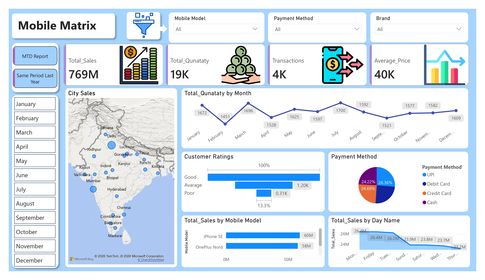

# Mobile-Matrix 

An enterprise-grade business intelligence and data analytics solution developed in Power BI. This suite provides interactive visualizations, structured data modeling, and robust time-intelligence reporting to track performance indicators, monitor growth velocity, and support data-driven decision-making.

## 🚀 Key Business Capabilities
* **Dynamic KPI Tracking:** Instant visibility into core operational metrics, performance targets, and strategic objectives.
* **Advanced Time-Intelligence:** Automated Month-to-Date (MTD) tracking and comparative period-over-period variance analysis.
* **Granular Data Exploration:** Interactive filtering across organizational dimensions, including regional, temporal, and product categories.

## 📂 Architecture & Repository Structure
```filepath
├── Assets/                 # UI/UX elements, themes, and wireframe backgrounds
├── Data/                   # Normalized source datasets and lookup tables
├── Dashboard.jpg           # Executive Overview UI preview
├── MTD Repoart.jpg         # Month-to-Date Performance UI preview
├── Same Period Last Year.jpg # Time-Intelligence Matrix UI preview
├── Mobile_Matrix.pbix     # Core Power BI application file (Data Model + UI)
└── README.md               # Solution documentation
```

## 📊 Analytical Views & Report Interfaces

### 1. Executive Performance Dashboard
Delivers a consolidated macro-level perspective of operational health, primary revenue drivers, and foundational matrix distributions.


### 2. Month-to-Date (MTD) Operational Report
Monitors running performance targets across active monthly horizons to facilitate agile tactical adjustments.


### 3. Comparative Period Analysis (SPLY)
Employs dedicated DAX measures to isolate variance and compute growth trajectories relative to historical equivalents.


## 🛠️ Data Engineering & Technology Stack
* **Data Connectivity & ETL:** Power Query (M) utilized for data extraction, schema normalization, type coercion, and deduplication.
* **Data Modeling:** Structured star-schema layout optimize relational performance and downstream calculation efficiency.
* **Analytical Calculations:** Custom DAX measures developed for specialized time-intelligence expressions (`SAMEPERIODLASTYEAR`, `TOTALMTD`).

## ⚙️ Deployment & Local Setup
To run or modify this data analytics application locally, follow these deployment steps:

